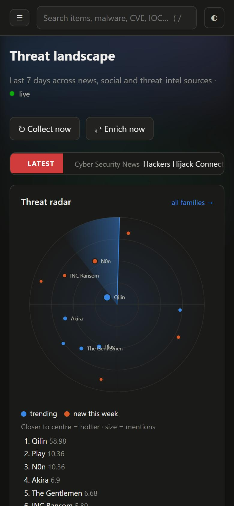

# JATMP — Just Another Threat Monitoring Platform

[](https://github.com/fj4rr/just-another-threat-monitoring-platform/actions/workflows/ci.yml)

A self-hosted platform for tracking new and emerging malware campaigns.
It combines **cybersecurity news**, **social media** (X, Bluesky, Mastodon) and **threat-intel platforms**
(VirusTotal, AlienVault OTX, urlscan.io, ANY.RUN, ThreatFox), cross-enriches the data between them, and shows
the result on a trend dashboard. Optionally, a local or API-hosted LLM adds extra insight.

Single process, SQLite by default, no JavaScript build step, no external CDN at runtime.

## Screenshots

Dashboard: threat radar, KPIs with sparklines, headline ticker, collection volume, trending families.


| Malware family page: timeline, coverage per source, co-occurring CVEs/actors/IOCs | Item page: content, extracted entities, correlated items from other sources |
|---|---|
|  |  |

| Feed with filters and severity | IOC table with verdicts and attributed families |
|---|---|
|  |  |

| Settings: sources, status and per-source actions | Mobile layout |
|---|---|
|  |  |

## Features

| Area | What you get |
|---|---|
| **News sources** | The Hacker News, Cyber Security News, BleepingComputer, SecurityWeek, The Record, Dark Reading, The DFIR Report, Unit 42, Malwarebytes Labs, SANS ISC, Krebs on Security, Cisco Talos, Securelist, Microsoft Security — add any other RSS feed from the UI |
| **Bluesky** (public API, no key) | vx-underground, Marcus Hutchins, MalwareHunterTeam, Kevin Beaumont, Catalin Cimpanu, Will Thomas (BushidoToken), Zack Whittaker, Lorenzo Franceschi-Bicchierai, Dan Goodin, Karsten Hahn, hasherezade, Silas Cutler, Shadowserver, The DFIR Report, ESET Research, Cisco Talos, SentinelLABS, GreyNoise, Huntress, Ransomware.live |
| **Mastodon** (public API, no key) | Marcus Hutchins, Brian Krebs, Brad Duncan (malware-traffic), SANS ISC, Proofpoint Threat Insight, Thomas Roccia, ffforward, Matt Taggart, Kevin Beaumont |
| **X / Twitter** (API v2 bearer token **or** an RSS bridge) | Enabled: vxunderground, MalwareTechBlog, malwrhunterteam. Available but **disabled** by default (enable them in Settings so the API quota isn't burned unintentionally): GossiTheDog, cyb3rops, 1ZRR4H, BushidoToken, TheDFIRReport, Unit42_Intel, abuse_ch, malware_traffic, ESETresearch, MsftSecIntel, executemalware, pr0xylife, g0njxa, Max_Mal_, RedDrip7, fr0gger_, StopMalvertisin, ViriBack, Fox_threatintel, FalconFeedsio, H4ckManac, anyrun_app, ffforward |
| **Threat-intel collectors** | OTX subscribed pulses / search, urlscan.io search, ANY.RUN TI Lookup query, latest ThreatFox IOCs |
| **Entity extraction** | Malware families (~150 families + aliases), threat actors (~45), CVEs, ATT&CK techniques, IOCs (IP, domain, URL, MD5/SHA1/SHA256 — including *defanged* ones such as `hxxp` and `[.]`). Detects **new** families that are not in the knowledge base yet (patterns like “`PipeMagic backdoor`”, “`WhiteArmor ransomware`”) |
| **Cross-source enrichment** | IOCs found in news and social posts are checked against VirusTotal, OTX, urlscan and ANY.RUN → verdict plus attributed family (e.g. a hash from a Bluesky post → “Lumma Stealer” from VT), which links it to other articles about that family. IOCs for trending families are pulled from OTX & ANY.RUN |
| **Correlation** | Item pages list items from other sources that share entities; entity pages show per-source coverage, co-occurrence, related IOCs and enrichment results |
| **Dashboard** | Animated: a *threat radar* (trending families as blips that light up as the sweep passes; closer to the centre = hotter), count-up KPIs with sparklines, a headline ticker, staggered card entrance, animated charts, 60-second auto-refresh (respects *prefers-reduced-motion*). Content: KPIs, volume per source type, trending families (score = 7-day rate vs 30-day baseline × source spread), top-5 family timeline, most-mentioned families, malware by type, IOC verdicts, items per source, hottest actors & CVEs |
| **AI (optional)** | Per-item summary + extraction, *threat brief* per family/actor, automatic *daily digest* at 06:00 UTC, Q&A over the collected data. Providers: **Ollama** (local), **OpenAI-compatible** (LM Studio, vLLM, llama.cpp, OpenRouter, OpenAI, Groq…), **Anthropic Claude** (official SDK, default `claude-opus-5-5`). Output language is configurable (e.g. *Bahasa Indonesia*) |
| **Install modes** | **Single-user** (no login) or **multi-user** (login, admin/analyst/viewer roles, admin dashboard: user management, job status, audit log, system stats) |
| **Other** | Per-user watchlist, dark/light theme, keyboard shortcut `/` for search, mobile layout, data retention, Docker with health check |

## Quick start (local)

```bash
python -m venv .venv
```
```bash
.venv\Scripts\activate        # Linux/macOS: source .venv/bin/activate
```
```bash
pip install -r requirements.txt
```
```bash
python install.py             # interactive: choose single / multi user, API keys, LLM
```
```bash
python run.py                 # open http://127.0.0.1:8000
```

Or skip `install.py`: on first launch the web UI shows the same **setup wizard**.
Non-interactive: `python install.py --mode multi --admin admin --password 'StrongPassw0rd'`.

> The web wizard requires no login (no users exist yet). Run the first install on `127.0.0.1`
> (the default) before exposing the port to a network.

### Docker

```bash
cp .env.example .env
```
```bash
docker compose up -d --build
```

The container exposes `/healthz` and ships a `HEALTHCHECK`. Local LLM in a container:
`docker compose --profile llm up -d`, then `docker compose exec ollama ollama pull llama3.1`
and set the base URL to `http://ollama:11434`.

## Configuration

All API keys and options can be set under **Settings** (admin role). A `.env` file next to `run.py`
(see `.env.example`) is loaded automatically; environment variables override the UI and are shown as locked there.

| Service | Key | Notes |
|---|---|---|
| VirusTotal | `VT_API_KEY` | Free tier is 4 req/min, 500/day — already throttled (`vt_min_interval`, `vt_daily_budget`) |
| AlienVault OTX | `OTX_API_KEY` | Free. Subscribe to pulses/users on OTX so the “subscribed” feed has content |
| urlscan.io | `URLSCAN_API_KEY` | The Search API now requires a key |
| ANY.RUN | `ANYRUN_API_KEY` | Requires a plan with **TI Lookup**. The base URL can be changed in Settings |
| abuse.ch ThreatFox | `ABUSECH_AUTH_KEY` | Free (Auth-Key from auth.abuse.ch) |
| X / Twitter | `X_BEARER_TOKEN` | API v2 is paid; alternatively set `rss_bridge` on each X source |

Runtime / deployment variables:

| Variable | Default | Purpose |
|---|---|---|
| `JATMP_HOST`, `JATMP_PORT` | `127.0.0.1`, `8000` | Bind address |
| `JATMP_DATA_DIR` | `./data` | Where `config.json` and the SQLite DB live |
| `JATMP_DATABASE_URL` | SQLite | e.g. `postgresql+psycopg://jatmp:secret@db:5432/jatmp` (install `psycopg[binary]`) |
| `JATMP_SECURE_COOKIES` | `0` | Set to `1` behind HTTPS: `Secure` session cookie + HSTS |
| `JATMP_FORWARDED_ALLOW_IPS` | `127.0.0.1` | Proxies allowed to set `X-Forwarded-*` (client IP in the audit log) |

### Adding malware families / actors without code changes

Create `data/knowledge_extra.json`:

```json
{
  "malware": {"WhiteArmor": {"category": "ransomware", "aliases": ["white armor"]}},
  "actors":  {"UNC9999": {"aliases": ["some alias"]}}
}
```

Restart, then run `python manage.py reextract` to reprocess existing items.

## Security notes

- **Strict Content-Security-Policy**: scripts only from the app's own origin plus a per-request nonce for the
  few inline blocks; no inline event handlers; Chart.js is vendored (`app/static/js/vendor`), so the UI works
  air-gapped. `X-Frame-Options: DENY`, `nosniff`, `Referrer-Policy`, `Permissions-Policy`, COOP and
  `Cache-Control: no-store` are set on every page.
- **Untrusted feed content**: HTML is stripped and entities decoded on ingest; item URLs are only kept when
  they are `http(s)` (a feed cannot smuggle a `javascript:` link into the UI); markdown from the LLM is
  rendered with raw HTML disabled.
- **Sessions & auth**: signed cookie sessions (`SameSite=Lax`, `HttpOnly`), CSRF synchronizer tokens on every
  POST, PBKDF2-HMAC-SHA256 with 600k iterations (older hashes are upgraded on login), 5 failed logins per
  username+IP lock the account for 15 minutes, open-redirect-safe `next` handling, session reset on login.
- **Settings hygiene**: secret values are never sent back to the browser (only “configured” / “not set”),
  integer settings are clamped (you cannot accidentally disable the VirusTotal throttle), source URLs must be
  `http(s)`.
- API keys set through the UI live in the local database. On shared hosts prefer environment variables, which
  lock the field in the UI. `data/config.json` holds the session secret and is written with mode `0600`.
- Run behind a TLS-terminating reverse proxy when exposing the platform beyond localhost and set
  `JATMP_SECURE_COOKIES=1`.

## Maintenance commands

```bash
python manage.py collect          # run every collector now (or: collect 1 5 7)
python manage.py enrich           # run one enrichment batch
python manage.py digest           # generate the AI digest now
python manage.py reextract        # re-extract entities on every item
python manage.py seed-sources     # add new built-in sources to an existing install (also a button in Settings)
python manage.py create-user alice analyst
```

## Development

```bash
pip install -r requirements-dev.txt
```
```bash
ruff check .
```
```bash
pytest
```

Tests run against a throw-away SQLite database (no network, no scheduler) and cover the extractor,
password/CSRF/redirect handling, feed sanitisation, the settings form and the multi-user login flow.
GitHub Actions runs lint + tests on Python 3.11 and 3.12 and builds the Docker image.

## Architecture

```
app/
  collectors/   rss, bluesky, mastodon, x_twitter, intel (OTX, urlscan, ANY.RUN, ThreatFox)  → RawItem
  processing/   pipeline (dedupe, sanitise, store, link entities) · extractor (IOC/CVE/family/actor)
                enrichment (cross-source) · trends (dashboard aggregations)
  intel/        API clients: VirusTotal, OTX, urlscan, ANY.RUN, ThreatFox (+ rate limits/budgets)
  llm/          client (Ollama / OpenAI-compatible / Anthropic) · insights (summary, brief, digest, Q&A)
  routers/      pages, api (JSON + actions), settings, admin, auth/setup
  jobs.py       APScheduler: one job per source, enrichment every N minutes, daily digest, housekeeping
  static/       app.css (theme tokens, dark/light) · app.js (CSP-safe behaviours, charts) · motion.js (radar, sparklines)
data/           config.json (install mode, secret), jatmp.db (SQLite)
tests/          pytest suite
```

The default database is SQLite (WAL mode). For larger deployments set `JATMP_DATABASE_URL` to PostgreSQL.
Run a single web worker: the scheduler lives in-process (scale collection by adjusting source intervals).

## Changelog

### 0.2.0

- Security: CSP with nonces, vendored Chart.js, no inline handlers, extra response headers, HSTS/Secure
  cookie switch, PBKDF2 600k with transparent upgrade, open-redirect hardening, source URL scheme checks,
  secret values no longer rendered into Settings, clamped numeric settings and query parameters.
- Bug fixes: `.env` was never loaded outside Docker; feed URLs with `javascript:` scheme reached `<a href>`;
  HTML entities in feeds were dropped instead of decoded; future-dated items showed “in 3h”; deprecated
  `datetime.utcnow()` usage; `canonical_malware` rebuilt the knowledge table on every call; per-entry
  duplicate checks on ingest; N+1 queries on the watchlist; mention counts left stale after retention cleanup.
- UX: no horizontal overflow on phones (dashboard glow extended past the viewport), modal popovers for source edit / password reset (usable on mobile), mobile sidebar with backdrop and
  Escape, “Remove” checkbox for secrets instead of typing `__clear__`, Reset buttons on filters, `/` focuses
  search, ARIA labels, skip link, focus rings, labelled inputs, grouped source list, radar blips fan out when
  scores tie, friendlier empty states.
- Tooling: pytest suite, ruff config, GitHub Actions CI, `.dockerignore`, Docker health check, `/healthz`.

## Notes

- All Bluesky & Mastodon accounts above were verified active on 12 Nov 2026. Exceptions: `vxunderground.bsky.social`
  has no posts yet, and Marcus Hutchins / MalwareHunterTeam rarely post on Bluesky — their main activity is on X
  (and Marcus is also on Mastodon). X handles can't be verified without an API token.
- The ANY.RUN TI Lookup endpoint (`/v1/intelligence/api/search`) has not been tested against a real key, and the
  official documentation could not be checked while writing it; the parser is defensive and the base URL is configurable.
- The severity score is a heuristic (keywords + entity types); the LLM can raise it during analysis.
