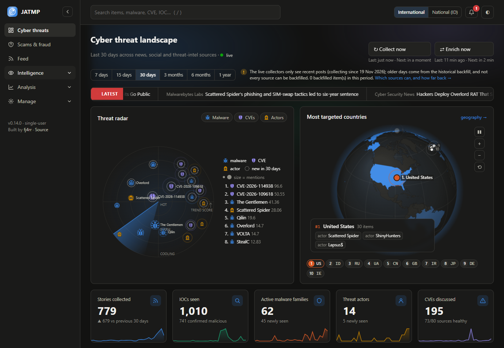

# JATMP — Just Another Threat Monitoring Platform

[](https://github.com/fj4rr/just-another-threat-monitoring-platform/actions/workflows/ci.yml)
[](https://fj4rr.github.io/just-another-threat-monitoring-platform/)

📖 **Documentation: [fj4rr.github.io/just-another-threat-monitoring-platform](https://fj4rr.github.io/just-another-threat-monitoring-platform/)**

JATMP is a self-hosted platform for keeping track of new and emerging malware campaigns and scams. It collects
**security news**, **social media** (X, Bluesky, Mastodon, Telegram) and **threat-intelligence platforms**,
extracts the malware families, actors, CVEs and indicators in each item, checks the indicators against intel
providers, correlates everything across sources and shows the result on a trend dashboard. Scam reports get a
dashboard of their own on the same entity graph, and items are sorted into critical infrastructure
sectors. Every item is placed on the map, and the whole interface switches between an
International and a National (Indonesia) view.

It runs as a single process with SQLite by default. There is no JavaScript build step and nothing is loaded from
a CDN at runtime, so it works on an isolated network.



More in the [screenshot tour](docs/screenshots.md).

## Features

- **Collection** from 14 English news feeds and 25 Indonesian ones (tech and general news), about 30 Bluesky and Mastodon accounts, X, public
  Telegram channels (no account needed), OTX, urlscan.io, ANY.RUN, ThreatFox, MISP and ransomware.live. Any RSS
  feed, account or channel can be added. → [Sources](docs/sources.md)
- **Analysis**: entity extraction with defang handling, an explainable 0–100 severity score, cross-provider
  verdict consensus (VirusTotal, OTX, abuse.ch, GreyNoise, AbuseIPDB and more), a relationship graph,
  on-demand infrastructure context, trend scoring over 7 days to a year, critical infrastructure sectors and CVE context from CISA KEV,
  FIRST EPSS and NVD.
  → [Analysis](docs/analysis.md)
- **Geography**: target, source and hosting countries kept apart, Indonesian provinces, an International /
  National (ID) switch and Bahasa Indonesia support. → [Geography and Indonesia](docs/geography.md)
- **Scams and fraud**: scam types, impersonated banks, e-wallets and government bodies, scammer phone numbers,
  accounts and wallets (kept to a minimum under UU PDP), losses in rupiah and a separate fraud score, from news,
  fact-checkers, FBI IC3 and the ScamSniffer blocklist, on their own dashboard. → [Scams and fraud](docs/fraud.md)
- **Sharing**: REST API with API keys, IOC blocklist feeds, STIX 2.1 / TAXII 2.1, signed webhooks
  (Slack, Discord, Teams) and two-way MISP, all behind TLP sharing rules. → [Sharing and integrations](docs/integrations.md)
- **Reporting and AI**: a *Threat Intel Findings* report as PDF, Word, Markdown or CSV, and optional summaries,
  briefs, a daily executive summary and Q&A from a local or cloud LLM. → [Reporting and AI](docs/reporting-and-ai.md)
- **History**: backfill up to a year back, retention tiers, full-text search and optional PostgreSQL.
  → [History and storage](docs/history-and-storage.md)
- **Operation**: single-user or multi-user with roles, live job progress, a notification center, a side preview on
  every table, dark and light themes and a phone layout. → [Using JATMP](docs/using-jatmp.md)

## Quick start

```bash
python -m venv .venv
```
```bash
.venv\Scripts\activate        # Linux/macOS: source .venv/bin/activate
```
```bash
pip install -r requirements.txt
```
```bash
python install.py             # interactive: single / multi user, API keys, LLM
```
```bash
python run.py                 # open http://127.0.0.1:8000
```

Or with Docker: copy `.env.example` to `.env` and run `docker compose up -d --build`. The installer can be
skipped, because the web UI shows the same setup wizard on first launch. Run that first launch on `127.0.0.1`
before exposing the port to a network. See [Getting started](docs/getting-started.md) for details.

## Documentation

| | |
|---|---|
| **Set up** | [Getting started](docs/getting-started.md) · [Configuration](docs/configuration.md) · [Upgrading](docs/upgrading.md) · [Maintenance commands](docs/maintenance.md) |
| **Use** | [Sources](docs/sources.md) · [Using JATMP](docs/using-jatmp.md) · [Analysis](docs/analysis.md) · [Geography](docs/geography.md) · [Scams and fraud](docs/fraud.md) · [Integrations](docs/integrations.md) · [Reporting and AI](docs/reporting-and-ai.md) · [History and storage](docs/history-and-storage.md) |
| **Reference** | [Security](docs/security.md) · [Development and architecture](docs/development.md) · [Changelog](CHANGELOG.md) |

The same pages are published as a searchable site at
**[fj4rr.github.io/just-another-threat-monitoring-platform](https://fj4rr.github.io/just-another-threat-monitoring-platform/)**
(built with MkDocs from [docs/](docs/README.md); `pip install -r requirements-docs.txt` and `mkdocs serve` to read
them locally).

## Credits

Built and maintained by [**fj4rr**](https://github.com/fj4rr) ·
[github.com/fj4rr/just-another-threat-monitoring-platform](https://github.com/fj4rr/just-another-threat-monitoring-platform).
Issues and pull requests are welcome.

Map outlines: [Natural Earth](https://www.naturalearthdata.com/) (public domain). Offline GeoIP, when downloaded:
[IP Geolocation by DB-IP](https://db-ip.com) (CC BY 4.0) or MaxMind GeoLite2 under its own licence.
