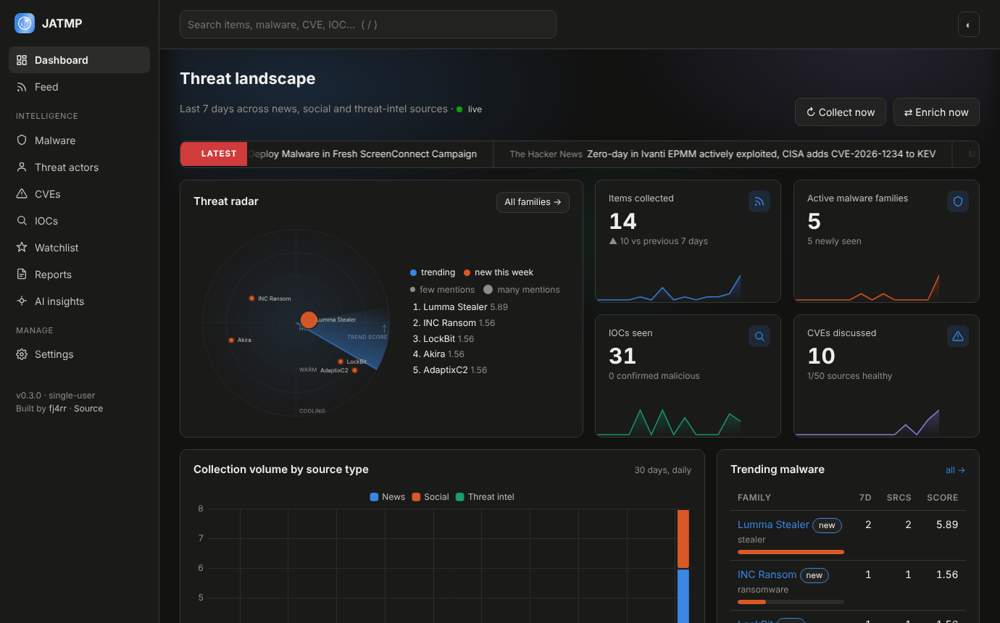
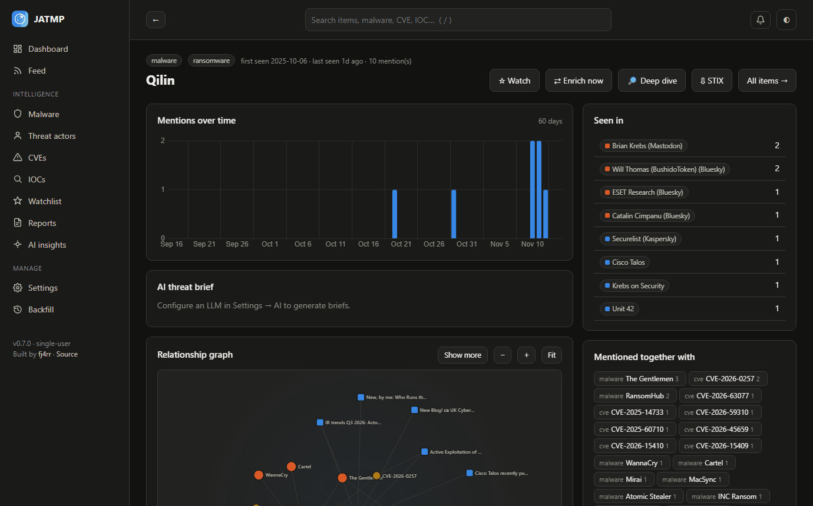
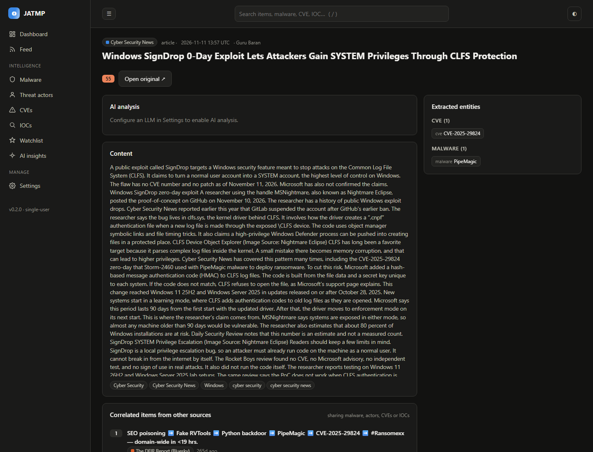
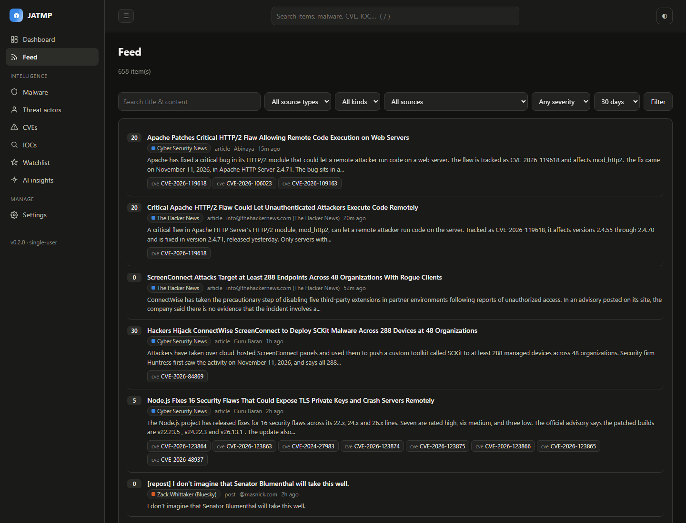
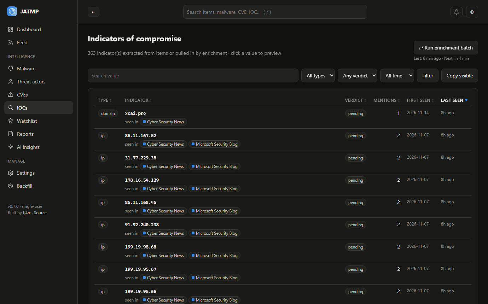
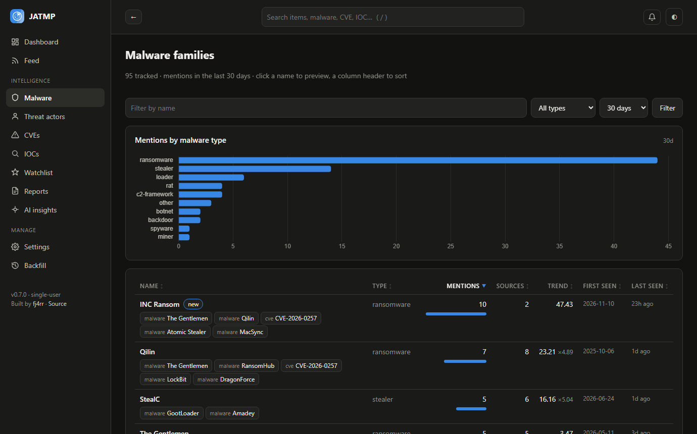
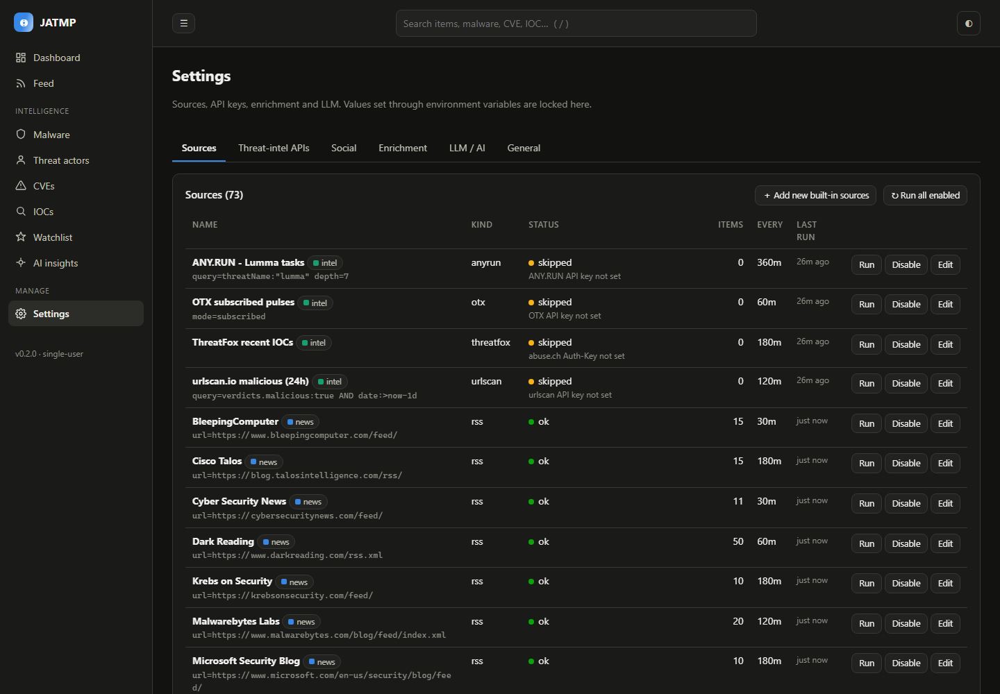
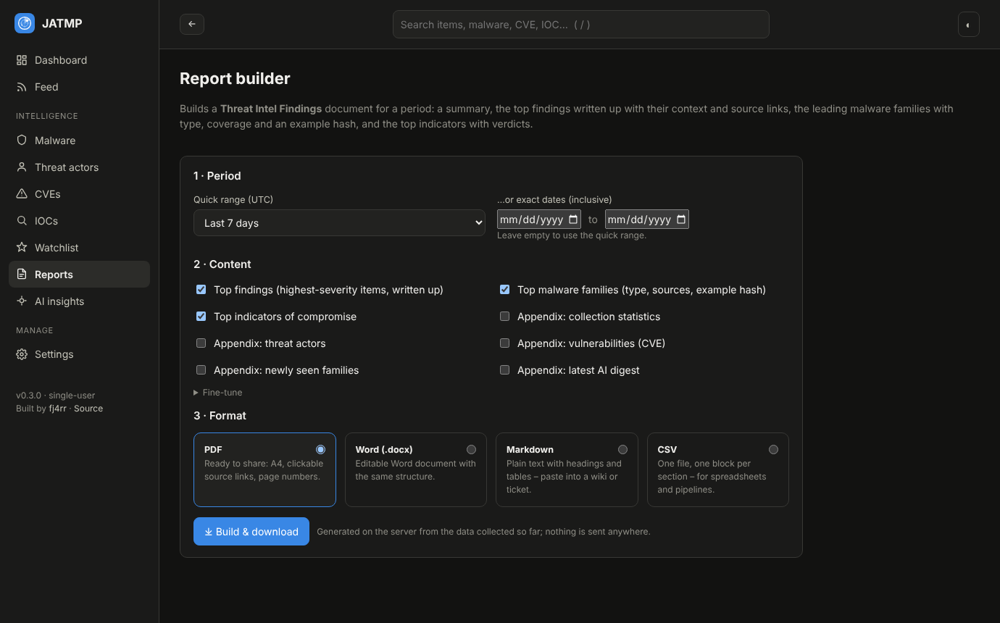

# JATMP — Just Another Threat Monitoring Platform

[](https://github.com/fj4rr/just-another-threat-monitoring-platform/actions/workflows/ci.yml)

JATMP is a self-hosted platform for keeping track of new and emerging malware campaigns. It pulls together
**security news**, **social media** (X, Bluesky, Mastodon) and **threat-intelligence platforms** (VirusTotal,
AlienVault OTX, urlscan.io, ANY.RUN, abuse.ch, GreyNoise, AbuseIPDB, MISP, ransomware.live), extracts the
malware families, actors, CVEs and indicators mentioned in each item, cross-checks indicators against the intel
providers, correlates everything across sources and presents the result on a trend dashboard. CVEs get
exploitation context from CISA KEV, FIRST EPSS and NVD. Other tools read the data back out through a REST API,
IOC blocklist feeds, signed webhooks and MISP. A local or cloud LLM can optionally add summaries, briefs and a
daily digest.

It runs as a single process with SQLite by default. There is no JavaScript build step and nothing is loaded
from a CDN at runtime, so it works on an isolated network.

## Screenshots

Dashboard: threat radar, KPI tiles (the icon opens the detail page), headline ticker, collection volume and
trending families.



| Malware family page: timeline, indicators, coverage per source, co-occurring CVEs and actors | Item page: severity breakdown, extracted entities and correlated items ranked by evidence |
|---|---|
|  |  |

| Feed: sortable table with severity, title and entities, source type and time | IOC table with verdicts, attributed families and where each indicator was seen |
|---|---|
|  |  |

| Malware families: sortable columns, trend score, mentions by type | AI settings: local or cloud, vendor presets and a live model list |
|---|---|
|  |  |

| Report builder: period, content and format for the *Threat Intel Findings* document |
|---|
|  |

## What it does

### Collection

| Source type | Included out of the box |
|---|---|
| **News (RSS)** | The Hacker News, Cyber Security News, BleepingComputer, SecurityWeek, The Record, Dark Reading, The DFIR Report, Unit 42, Malwarebytes Labs, SANS ISC, Krebs on Security, Cisco Talos, Securelist, Microsoft Security. Any other RSS or Atom feed can be added from the UI. |
| **Bluesky** (public API, no key) | vx-underground, Marcus Hutchins, MalwareHunterTeam, Kevin Beaumont, Catalin Cimpanu, Will Thomas (BushidoToken), Zack Whittaker, Lorenzo Franceschi-Bicchierai, Dan Goodin, Karsten Hahn, hasherezade, Silas Cutler, Shadowserver, The DFIR Report, ESET Research, Cisco Talos, SentinelLABS, GreyNoise, Huntress, Ransomware.live |
| **Mastodon** (public API, no key) | Marcus Hutchins, Brian Krebs, Brad Duncan (malware-traffic), SANS ISC, Proofpoint Threat Insight, Thomas Roccia, ffforward, Matt Taggart, Kevin Beaumont |
| **X / Twitter** (API v2 bearer token or an RSS bridge) | Enabled: vxunderground, MalwareTechBlog, malwrhunterteam. Available but disabled by default so the API quota is not spent unintentionally: GossiTheDog, cyb3rops, 1ZRR4H, BushidoToken, TheDFIRReport, Unit42_Intel, abuse_ch, malware_traffic, ESETresearch, MsftSecIntel, executemalware, pr0xylife, g0njxa, Max_Mal_, RedDrip7, fr0gger_, StopMalvertisin, ViriBack, Fox_threatintel, FalconFeedsio, H4ckManac, anyrun_app, ffforward |
| **Threat-intel collectors** | OTX subscribed pulses and searches, urlscan.io searches, ANY.RUN TI Lookup queries, the latest ThreatFox IOCs, MISP events, ransomware.live leak-site victims (recent, per group or per country; disabled by default, see below) |

### Analysis

**Entity extraction.** Each item is scanned for malware families (about 150 families plus aliases), threat actors
(about 45), CVEs, ATT&CK techniques and indicators (IPs, domains, URLs, MD5/SHA1/SHA256). Defanged indicators
are understood in their common forms (`hxxp`, `[.]`, `[:]`, `[://]`, `\.`, `(dot)`). Families that are not in
the knowledge base yet are picked up from phrases such as "PipeMagic backdoor", while legitimate tools that
attackers abuse (ConnectWise, AnyDesk, PsExec and others) are never promoted to families. Hashes that are part
of a URL, version numbers that look like IP addresses and roughly 200 vendor, media and platform domains are
ignored.

**Severity.** Every item receives an explainable score from 0 to 100. Signals are grouped (exploitation,
impact, threat class, activity) so that synonyms are not counted twice; the strongest term in a group counts in
full and the runner-up at half weight. Matches in the title weigh 1.5 times more than matches in the body.
Patch notes, roundups and guides, and routine leak-site victim postings are damped, and an indicator that is
later confirmed malicious raises the score of the items that mention it. The item page shows the full
breakdown.

**Cross-source enrichment.** Indicators found in news and social posts are looked up on VirusTotal, OTX,
urlscan, ANY.RUN, MalwareBazaar (hashes), URLhaus (URLs, hosts, payloads), GreyNoise and AbuseIPDB (IPs),
whichever have keys. The verdicts are combined into a consensus: any provider reporting *malicious* wins,
infrastructure that OTX whitelists is marked clean, and a lone OTX pulse mention is treated as suspicious rather
than malicious. GreyNoise works as a false-positive filter: an IP it knows as a benign business service or
benign scanner is marked clean unless a strong provider (VirusTotal, abuse.ch, ANY.RUN) says otherwise, and
mass scanners get a "mass scanner" badge (opportunistic, not targeted). Lookups that failed are retried after six hours, *unknown* results are re-checked after three
days, and families attributed by a provider (a hash on Bluesky identified as Lumma Stealer, for example) are
linked back so the indicator connects to the articles about that family. Indicators for trending families are
pulled from OTX and ANY.RUN, accepting only pulses that actually name the family.

**Correlation.** The item page ranks related items by the strength of the evidence they share: a common hash,
URL or domain weighs far more than a common CVE, rare entities more than frequently mentioned ones, and items
from another source or source type receive a bonus. Entity pages show coverage per source, co-occurring
entities, related indicators and enrichment results.

**Trends.** The dashboard scores each family by its recent mention rate against a 30-day baseline, weighted by
how many sources and source types cover it, and shows the result as a radar, timelines and tables. The same
score drives the *Trending CVEs* and *Trending threat actors* widgets, which also list the families, actors
and CVEs mentioned alongside each entry.

**Vulnerability context.** Every six hours, CVEs mentioned in the last 30 days are looked up in the CISA Known
Exploited Vulnerabilities catalog, FIRST EPSS and the NVD (CVSS score, vector and description). None of these
needs a key; an optional NVD key only makes the CVSS lookups faster. Trending CVEs are ranked by exploitation
risk as well as chatter (trend score × 2 when in KEV × (1 + EPSS) × (0.5 + CVSS/10)), and the CVE list can be
sorted by CVSS or EPSS.

### Sharing and integrations

**REST API v1** (`/api/v1/…`, reference at `/api/v1/docs`, served offline). Read-only endpoints for items,
entities, indicators and trends with cursor pagination and `since` filters, so SIEMs, TIPs and scripts can poll
incrementally. Authentication is a personal API key (`Authorization: Bearer jatmp_…`) created under **Profile →
API keys** with scopes (`read`, `export`), an expiry, a per-key rate limit and revocation; only a hash of the key
is stored. Browser sessions work too.

**IOC export feeds.** `/api/v1/feeds/iocs.csv`, `.json` and `.txt`, filtered by type, verdict (default
*malicious*), family, age and a 0–100 confidence that grows with the number of providers agreeing. The `.txt`
feed has one value per line and works as a firewall or proxy blocklist (for example a Palo Alto EDL or a
FortiGate threat feed).

**Webhooks** (Settings → Webhooks): new high-severity item, watched entity mentioned, indicator turned malicious,
job failed. Generic receivers get signed JSON (`X-JATMP-Signature: sha256=HMAC(secret, "<timestamp>.<body>")`);
Slack, Discord and Teams get ready-made messages. Deliveries retry with back-off and are listed with their status.

**MISP, both ways.** A *MISP events* source pulls events (attributes become indicators, galaxy clusters become
actors and families, the event TLP is kept). *Send to MISP* on item and family / actor pages creates an event with
TLP and family tags and the indicators as attributes, and new items above a severity threshold can be pushed
automatically. Events that came from MISP are never pushed back.

**Sharing rules.** Everything above goes through one set of rules: items carry a TLP (their own, from OTX or
MISP, or their source's), and only items up to the configured maximum (default TLP:GREEN) leave JATMP. Sources
can be marked "not shared" (ANY.RUN and ransomware.live are by default, because of their terms), and
third-party provider details stay in-house unless an admin enables them; JATMP's own verdict is always shared.

### Dark web (tier 1)

Clearnet aggregators only: JATMP never visits leak sites or forums, logs in anywhere, solves CAPTCHAs or
downloads leaked data. **Deep dive** on a ransomware family or actor page asks ransomware.live for the group's
leak-site victims (count, countries, sectors, recent victims, CVEs it exploits, tools) and links the CVEs. On a
domain page it asks Hudson Rock how many employees and users of that domain were infected by infostealers
(counts only, never credentials). ransomware.live's keyless API is for personal use only, so organisations
should add the free PRO key; the ransomware.live sources are seeded disabled for that reason.

### Reporting

The report builder produces a **Threat Intel Findings** document for any period, as PDF, Word, Markdown or CSV.
It opens with a summary of the period, writes up the top findings (published time, severity, description,
related malware, actors and CVEs, and a link to the original), lists the leading malware families with their
type, the sources that covered them and an example hash, and closes with the top indicators of compromise and
their verdicts. Collection statistics, actors, CVEs, newly seen families and the latest AI digest can be
appended. The number of findings, families and indicators is adjustable.

### AI (optional)

With an LLM configured, JATMP can summarise and analyse individual items, write a threat brief per family or
actor, produce a daily digest at 06:00 UTC and answer questions over the collected data. Set-up is a three-way
choice between **Off**, **Local** and **Cloud**, followed by a vendor and a model picked from the live list the
server or provider reports. Local runtimes: Ollama, LM Studio, llama.cpp, vLLM, Jan or any OpenAI-compatible
server. Cloud providers: Anthropic, OpenAI, OpenRouter, Groq, Gemini, Mistral, DeepSeek, xAI, Together or any
OpenAI-compatible API. The output language is configurable.

### Operation

JATMP installs in **single-user** mode (no login) or **multi-user** mode with admin, analyst and viewer roles,
user management, job status and an audit log. Users keep a personal watchlist, and the interface offers a dark
and a light theme, a `/` shortcut for search, a phone layout, configurable data retention and a Docker image
with a health check.

**Tables and preview.** The Feed, IOC, Malware, Threat actor and CVE lists share one table design: sortable
headers that stay visible while scrolling, a bold primary column with a secondary line and a row of related
entities, the same period filter (24 hours to 1 year, or all time), a Reset button and pagination. Clicking a
title opens a **side preview** with the essentials (severity breakdown, AI summary, indicators and their
verdicts, provider results, related items); ↑ / ↓ (or j / k) move to the previous or next row, Esc closes it,
*Full page* opens the detail page in a new tab and the URL (`?preview=item:12`) can be shared. Ctrl / Cmd /
middle-click still open the page itself.

**Job status and notifications.** Under *Collect now* and *Enrich now* the dashboard shows when each job last
ran and when it runs next, and a live progress bar while it runs ("Collecting… 12/50 sources · 8 new"); the
button stays disabled until the run finishes. The bell in the top bar collects the results: one summary per
manual collection ("Collected 42 new items from 50 sources, 2 errors"), sources that start failing, failed
enrichment runs, the VirusTotal daily quota being used up and the AI digest being ready. Notifications are kept
for 30 days.

## Quick start

```bash
python -m venv .venv
```
```bash
.venv\Scripts\activate        # Linux/macOS: source .venv/bin/activate
```
```bash
pip install -r requirements.txt
```
```bash
python install.py             # interactive: single / multi user, API keys, LLM
```
```bash
python run.py                 # open http://127.0.0.1:8000
```

The installer can be skipped: on first launch the web UI shows the same setup wizard. For an unattended
install use `python install.py --mode multi --admin admin --password 'StrongPassw0rd'`.

> The web wizard requires no login because no users exist yet. Run the first install on `127.0.0.1` (the
> default) before exposing the port to a network.

### Docker

```bash
cp .env.example .env
```
```bash
docker compose up -d --build
```

The container exposes `/healthz` and ships a `HEALTHCHECK`. To run a local LLM alongside it, start
`docker compose --profile llm up -d`, pull a model with `docker compose exec ollama ollama pull llama3.1` and
set the base URL to `http://ollama:11434` under Settings → AI → Advanced.

## Configuration

API keys and options are managed under **Settings** (admin role). A `.env` file next to `run.py` (see
`.env.example`) is loaded automatically; values set through environment variables take precedence over the UI
and are shown there as locked.

| Service | Variable | Notes |
|---|---|---|
| VirusTotal | `VT_API_KEY` | Free tier allows 4 requests/min and 500/day; both limits are enforced (`vt_min_interval`, `vt_daily_budget`) |
| AlienVault OTX | `OTX_API_KEY` | Free. Subscribe to pulses or users on OTX so the "subscribed" feed has content |
| urlscan.io | `URLSCAN_API_KEY` | The Search API requires a key |
| ANY.RUN | `ANYRUN_API_KEY` | Requires a plan with TI Lookup; the base URL can be changed in Settings |
| abuse.ch ThreatFox | `ABUSECH_AUTH_KEY` | Free (Auth-Key from auth.abuse.ch) |
| NVD | `NVD_API_KEY` | Optional. CISA KEV, FIRST EPSS and NVD work without a key; with one, CVSS lookups are faster (50 per run instead of 10). The whole CVE lookup can be turned off under Settings → Enrichment |
| abuse.ch MalwareBazaar, URLhaus | `ABUSECH_AUTH_KEY` | Same free Auth-Key as ThreatFox |
| GreyNoise Community | `GREYNOISE_API_KEY` | Free; small daily quota (`greynoise_daily_budget`, default 40) |
| AbuseIPDB | `ABUSEIPDB_API_KEY` | Free tier allows 1,000 checks/day (`abuseipdb_daily_budget`, default 900) |
| ransomware.live | `RANSOMWARELIVE_API_KEY` | Free PRO key; required for organisational use. Without it the personal-use API (one request per minute per endpoint) is used |
| Hudson Rock Cavalier | `HUDSONROCK_API_KEY` | Free key for the infostealer deep dive |
| MISP | `MISP_URL`, `MISP_API_KEY` | Automation key of a MISP user; distribution, sharing group, TLS verification and auto-push under Settings → MISP |
| X / Twitter | `X_BEARER_TOKEN` | API v2 is a paid service; alternatively set `rss_bridge` on each X source |
| LLM | `LLM_PROVIDER`, `LLM_BASE_URL`, `LLM_MODEL`, `LLM_API_KEY` | Optional. `LLM_PROVIDER` is `none`, `ollama`, `openai_compatible` or `anthropic`; the Settings page reflects whatever these resolve to |

Runtime and deployment variables:

| Variable | Default | Purpose |
|---|---|---|
| `JATMP_HOST`, `JATMP_PORT` | `127.0.0.1`, `8000` | Bind address |
| `JATMP_DATA_DIR` | `./data` | Location of `config.json` and the SQLite database |
| `JATMP_DATABASE_URL` | SQLite | For example `postgresql+psycopg://jatmp:secret@db:5432/jatmp` (install `psycopg[binary]`) |
| `JATMP_SECURE_COOKIES` | `0` | Set to `1` behind HTTPS: `Secure` session cookie and HSTS |
| `JATMP_FORWARDED_ALLOW_IPS` | `127.0.0.1` | Proxies allowed to set `X-Forwarded-*` (client IP in the audit log) |
| `JATMP_PUBLIC_URL` | empty | Public base URL used for links in API output, webhooks and MISP events |

### Extending the knowledge base

Malware families and actors can be added without touching code. Create `data/knowledge_extra.json`:

```json
{
  "malware": {"WhiteArmor": {"category": "ransomware", "aliases": ["white armor"]}},
  "actors":  {"UNC9999": {"aliases": ["some alias"]}}
}
```

Restart, then run `python manage.py reextract` to reprocess existing items.

### Upgrading to 0.5

Automatic on start-up: new tables (`api_keys`, `webhooks`, `webhook_deliveries`) and columns (`sources.tlp`,
`sources.redistribute`, `items.tlp`). Run **Add new built-in sources** under Settings → Sources to get the two
ransomware.live sources (disabled). Existing items have no TLP of their own and count as their source's TLP
(CLEAR unless you set one). In single-user mode the API, like the rest of the app, needs no login; keep such an
install on localhost or use multi-user mode before exposing it.

### Upgrading to 0.4

Nothing to do by hand: on start-up the new `notifications` table is created and the new columns on
`collector_runs` and `users` are added. The first CVE lookup runs three minutes after start-up and fills in
KEV / EPSS / CVSS for CVEs mentioned in the last 30 days; press **Refresh CVE intel** on the CVE page or run
`python manage.py cve-intel` to start it right away.

### Upgrading to 0.3

Severity scores and their breakdowns are computed when an item is ingested. Items collected by an earlier
version keep their old score until you run `python manage.py rescore` or press **Re-score all items** under
Settings → General; this is a local pass over the database and makes no network requests. The new
`severity_detail` column is added automatically on start-up. Word and PDF export need two additional
packages, so run `pip install -r requirements.txt` again.

## Security notes

- **Content-Security-Policy.** Scripts load only from the application's origin plus a per-request nonce for the
  few inline blocks; there are no inline event handlers, and Chart.js is vendored under `app/static/js/vendor`.
  `X-Frame-Options: DENY`, `nosniff`, `Referrer-Policy`, `Permissions-Policy`, COOP and
  `Cache-Control: no-store` are set on every page.
- **Untrusted feed content.** HTML is stripped and entities are decoded on ingest. Item URLs are kept only when
  they use `http(s)`, so a feed cannot smuggle a `javascript:` link into the UI. Markdown returned by the LLM is
  rendered with raw HTML disabled.
- **Sessions and authentication.** Signed cookie sessions (`SameSite=Lax`, `HttpOnly`), CSRF synchroniser
  tokens on every POST, PBKDF2-HMAC-SHA256 with 600k iterations (older hashes are upgraded on login), a
  15-minute lockout after five failed logins per username and IP, open-redirect-safe `next` handling and a
  session reset on login.
- **Settings hygiene.** Secret values are never sent back to the browser (only "configured" or "not set"),
  numeric settings are clamped so the VirusTotal throttle cannot be disabled by accident, and source URLs must
  be `http(s)`.
- **Outbound API.** API keys are 256-bit random secrets of which only a SHA-256 is stored; they carry scopes,
  expire, can be revoked by their owner or an admin, and are rate limited per key. Key creation, revocation and
  feed downloads are written to the audit log. Bearer requests need no CSRF token; every cookie-authenticated
  POST still does.
- **Webhooks.** Targets must resolve to public addresses (checked when saved and again before each delivery;
  redirects are not followed) unless an admin allows private ones. Signing secrets are derived from the session
  secret and a per-hook salt, so the database holds nothing that could forge a signature.
- **Sharing.** TLP and per-source redistribution flags gate the API, exports, webhooks and MISP pushes (see
  *Sharing and integrations*).
- API keys entered in the UI are stored in the local database. On shared hosts prefer environment variables,
  which lock the corresponding fields. `data/config.json` holds the session secret and is written with mode
  `0600`.
- When exposing the platform beyond localhost, run it behind a TLS-terminating reverse proxy and set
  `JATMP_SECURE_COOKIES=1`.

## Maintenance commands

```bash
python manage.py collect          # run every collector now (or a subset: collect 1 5 7)
python manage.py enrich           # run one enrichment batch
python manage.py cve-intel        # refresh CISA KEV / EPSS / CVSS for recently mentioned CVEs
python manage.py digest           # generate the AI digest now
python manage.py reextract        # re-extract entities on every item
python manage.py rescore          # recompute severity with the current rules (also a button in Settings → General)
python manage.py seed-sources     # add new built-in sources to an existing install (also a button in Settings)
python manage.py create-user alice analyst
```

## Development

```bash
pip install -r requirements-dev.txt
```
```bash
ruff check .
```
```bash
pytest
```

The test suite runs against a throw-away SQLite database with no network access and no scheduler. It covers
the extractor, severity scoring, enrichment consensus, feed sorting, the AI settings mapping, the report
builder in all four formats, password, CSRF and redirect handling, feed sanitisation, the settings form, the
multi-user login flow, list pagination and filters, the preview fragments, job batches and progress,
notifications and the CVE lookups (against a mocked HTTP transport). GitHub Actions runs lint and tests on Python 3.11 and 3.12 and builds the Docker
image.

## Architecture

```
app/
  collectors/   rss, bluesky, mastodon, x_twitter, intel (OTX, urlscan, ANY.RUN, ThreatFox, ransomware.live),
                misp  → RawItem
  processing/   pipeline (dedupe, sanitise, store, link entities) · extractor (IOC/CVE/family/actor)
                severity (explainable 0–100 score) · enrichment (cross-source, consensus, re-checks)
                trends (dashboard aggregations, weighted correlation)
  intel/        API clients: VirusTotal, OTX, urlscan, ANY.RUN, ThreatFox, MalwareBazaar, URLhaus, GreyNoise,
                AbuseIPDB (rate limits, budgets, connection tests) · darkweb (ransomware.live, Hudson Rock)
                misp (pull mapping, push, auto-push)
                cve (CISA KEV, FIRST EPSS, NVD CVSS → Entity.meta; risk-weighted CVE priority)
  llm/          client (Ollama / OpenAI-compatible / Anthropic, live model list) · presets (local and cloud vendors)
                insights (summary, brief, digest, Q&A)
  reports.py    Threat Intel Findings: gather() plus PDF / Word / Markdown / CSV exporters
  routers/      pages, api (JSON and actions), api_v1 (REST API + IOC feeds + offline docs), apikeys, webhooks,
                settings, reports, admin, auth and setup
  sharing.py    TLP and redistribution rules for everything that leaves JATMP
  apikeys.py    API key creation, verification, scopes and rate limiting
  webhooks.py   events, Slack / Discord / Teams formats, HMAC signing, SSRF guard, retries
  jobs.py       APScheduler: one job per source, enrichment every N minutes, CVE intel every 6 h, daily digest,
                housekeeping; manual runs as batches with live progress (status() feeds /api/jobs/status)
  notify.py     notification center (de-duplicated by key, per-user read watermark, 30-day retention)
  templates/    pages, plus _preview_item.html / _preview_entity.html (partial HTML for the side preview)
  static/       app.css (theme tokens, dark and light) · app.js (CSP-safe behaviours, preview drawer, job and
                notification polling, charts) · motion.js (radar, sparklines)
data/           config.json (install mode, secret), jatmp.db (SQLite)
tests/          pytest suite
```

SQLite in WAL mode is the default database; for larger deployments point `JATMP_DATABASE_URL` at PostgreSQL.
Run a single web worker, because the scheduler lives in the process; scale collection by adjusting source
intervals instead.

## Changelog

### 0.5.0

- **New providers.** MalwareBazaar (hash → family, tags), URLhaus (URL / host / payload status), GreyNoise
  Community (mass scanner vs benign service, used to cut false positives in the consensus) and AbuseIPDB
  (confidence score). MalwareBazaar and URLhaus use the existing abuse.ch Auth-Key. Every provider has a
  *Test connection* button under Settings → Threat-intel APIs, using account or status endpoints where
  available so no lookup quota is spent.
- **REST API v1 and API keys.** `/api/v1/items`, `/entities`, `/iocs`, `/trending` with cursor pagination and
  `since`; API keys with scopes, expiry, revocation, per-key rate limit and audit entries (Profile → API keys,
  admin overview on the admin page); offline reference at `/api/v1/docs` and `/api/v1/openapi.json`.
- **IOC export feeds** in CSV, JSON and plain text (blocklists), filtered by type, verdict, family, age and
  confidence.
- **Webhooks** with HMAC-signed generic JSON or Slack / Discord / Teams formats, four events, test button,
  secret rotation, retry with back-off, delivery log and an SSRF guard.
- **Sharing rules.** TLP per item (from OTX / MISP) and per source, a maximum TLP for everything outbound,
  per-source "share outside JATMP" (ANY.RUN and ransomware.live off by default) and provider details kept
  in-house unless enabled.
- **Dark web tier 1.** ransomware.live collector (recent, per group, per country; PRO key or the personal-use
  API) and a *Deep dive* button: leak-site victims, countries, sectors, exploited CVEs and tools for ransomware
  families and actors, Hudson Rock infostealer statistics for domains.
- **MISP pull and push**: events as a source, *Send to MISP* for items and families / actors, optional auto-push
  above a severity threshold, no echo of MISP-sourced items, duplicate pushes link to the existing event.
- Fix: API error responses now keep `WWW-Authenticate` and `Retry-After` headers.

### 0.4.0

- **Unified tables.** IOC, Malware, Threat actor and CVE lists now use the Feed's table design (generic
  `.data-table`): bold primary column, secondary line, related-entity chips, the same period filter including
  *1 year* and *All time*, Reset and pagination (the entity lists used to stop at 300 rows). Headers stay
  visible while scrolling; a table wider than its card scrolls horizontally instead.
- **Side preview.** A click on a title in the Feed, IOC, Malware, Actor or CVE tables, in the dashboard
  widgets or on detail pages opens a slide-over preview served by `GET /items/{id}/preview` and
  `GET /entities/{id}/preview` (partial HTML, same auth as the pages). Keyboard navigation (↑ / ↓, j / k, Esc),
  focus trap, a shareable `?preview=` URL, *Full page* in a new tab and a full-screen sheet on phones.
- **Job status and progress.** *Collect now* queues one run per source under a batch id and shows
  "Collecting… 12/50 sources · 8 new" with a progress bar; *Enrich now* and the new *Refresh CVE intel* show
  per-indicator / per-CVE progress. Each button shows "Last … · Next …" from the scheduler and stays disabled
  (and refuses a second run server-side) while its job runs. `GET /api/jobs/status`; the page polls every
  60 s, or every 2.5 s while something runs. Runs interrupted by a restart are marked *aborted*.
- **Notification center.** Bell with unread count in the top bar on every page: collection batch summaries,
  sources that start failing (on the transition, not on every failed run), failed enrichment runs, the
  VirusTotal quota being reached, the AI digest being ready and re-scoring finished. A new notification also
  shows as a toast. `GET /api/notifications`, `POST /api/notifications/read`; kept for 30 days.
- **CVE and actor widgets.** *Trending CVEs* (KEV badge, CVSS, EPSS, risk-weighted priority, co-mentioned
  families and actors) and *Trending threat actors* (growth, linked families and CVEs) replace the chip list on
  the dashboard. CVE pages get a *Vulnerability intel* card and the CVE list gained CVSS / EPSS columns.
- **CVE intel job** (`app/intel/cve.py`): CISA KEV (cached on disk for 12 h), FIRST EPSS and NVD CVSS every
  6 hours; the NVD is throttled to its public rate limit and skipped for the rest of a run when it keeps
  failing. New settings: *CVE context* (on by default) and an optional NVD API key. `manage.py cve-intel`.
- Fix: "All time" on the Feed was lost when sorting or paging.

### 0.3.0

- **Severity rewritten** (`app/processing/severity.py`). Grouped signals replace the flat keyword sum, with
  title weighting, dampeners for patch notes, roundups and non-incident news, a cap for routine leak-site
  victim postings, entity signals and a stored breakdown that the item page displays. `manage.py rescore` and
  a button under Settings → General re-score existing items.
- **Extraction.** Additional defang styles (`[:]`, `[://]`, `\.`, `(dot)`, `fxp`); hashes embedded in URLs
  and tracking IDs are skipped, as are version numbers that resemble IP addresses; a much larger benign-domain
  list; a denylist of legitimate tools for the new-family heuristic.
- **Enrichment.** Provider consensus (a lone OTX pulse hit is suspicious, not malicious; OTX whitelist means
  clean); lookups that all failed are retried after six hours instead of being marked done; *unknown*
  indicators are re-checked after three days; confirmed verdicts raise the severity of the items that mention
  the indicator; family attribution ignores ambiguous tokens; OTX family searches only accept pulses that name
  the family; fewer secondary urlscan IPs are created.
- **Correlation.** Related items are ranked by evidence strength (type weight divided by log mentions, with an
  other-source bonus) and the shared entities are listed.
- **Feed** is a table with sortable Severity, Title, Source and Time headers; the separate sort buttons are
  gone. Dashboard KPI tiles keep the icon link only.
- **AI settings** reduced to Off / Local / Cloud, vendor and model, with presets for six local runtimes and ten
  cloud providers, a live model list and an advanced base-URL override. The classic `LLM_*` variables still
  work and are reflected in the new UI.
- **Report builder** (`/reports`): a *Threat Intel Findings* document with a period summary, written-up top
  findings, leading malware families (type, coverage, example hash), top indicators and an optional appendix,
  exported as PDF, Word, Markdown or CSV.
- Fix: modal popovers (source edit, severity breakdown) opened inside their card after the entrance animation.
- New dependencies: `python-docx` and `reportlab` for Word and PDF export.

### 0.2.1

- Sortable columns on the Malware, Threat actors, CVEs and IOCs tables; the feed can be sorted by time or
  severity; the IOC table shows where each indicator was seen; family and actor pages gained an Indicators card
  with a link to all related IOCs (`/iocs?entity=ID`).
- Dashboard: KPI tiles link to their detail pages, the radar explains placement with an axis key, "All
  families" is a button, and the items-per-source chart shows the top 12 with readable labels.
- Chrome: new radar logo, brand links home, back button, burger menu only on small screens, "Add source" moved
  above the table as a full-width panel, credits in the sidebar.

### 0.2.0

- Security: CSP with nonces, vendored Chart.js, no inline handlers, extra response headers, HSTS and Secure
  cookie switch, PBKDF2 600k with transparent upgrade, open-redirect hardening, source URL scheme checks,
  secret values no longer rendered into Settings, clamped numeric settings and query parameters.
- Bug fixes: `.env` was never loaded outside Docker; feed URLs with a `javascript:` scheme reached `<a href>`;
  HTML entities in feeds were dropped instead of decoded; future-dated items showed "in 3h"; deprecated
  `datetime.utcnow()` usage; `canonical_malware` rebuilt the knowledge table on every call; per-entry duplicate
  checks on ingest; N+1 queries on the watchlist; mention counts left stale after retention cleanup.
- UX: no horizontal overflow on phones, modal popovers for source edit and password reset, mobile sidebar with
  backdrop and Escape, a "Remove" checkbox for secrets, Reset buttons on filters, `/` focuses search, ARIA
  labels, skip link, focus rings, labelled inputs, grouped source list, radar blips fan out when scores tie,
  friendlier empty states.
- Tooling: pytest suite, ruff configuration, GitHub Actions CI, `.dockerignore`, Docker health check,
  `/healthz`.

## Credits

Built and maintained by [**fj4rr**](https://github.com/fj4rr) ·
[github.com/fj4rr/just-another-threat-monitoring-platform](https://github.com/fj4rr/just-another-threat-monitoring-platform).
Issues and pull requests are welcome.

## Notes

- The Bluesky and Mastodon accounts listed above were verified active on 12 November 2026, with three
  exceptions: `vxunderground.bsky.social` has no posts yet, and Marcus Hutchins and MalwareHunterTeam rarely
  post on Bluesky (their main activity is on X; Marcus Hutchins is also on Mastodon). X handles cannot be
  verified without an API token.
- The ANY.RUN TI Lookup endpoint (`/v1/intelligence/api/search`) has not been exercised against a real key, and
  the official documentation could not be checked while it was written; the parser is defensive and the base
  URL is configurable.
- The severity score is a triage heuristic, not a vulnerability rating. The item page shows how a score was
  built, enrichment raises it when an indicator is confirmed malicious, and the LLM can raise it during
  analysis.
- The model names offered in the AI presets were current when this version was written. Use **Load models**
  to see what your server or provider actually offers.
