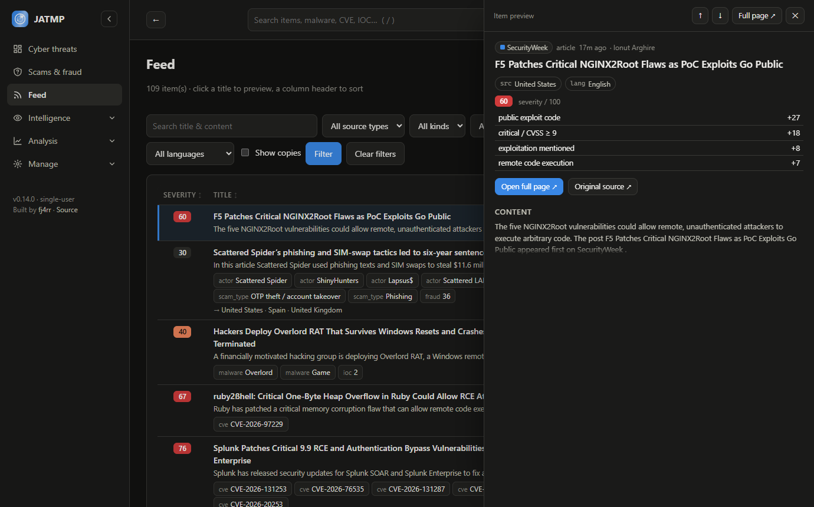
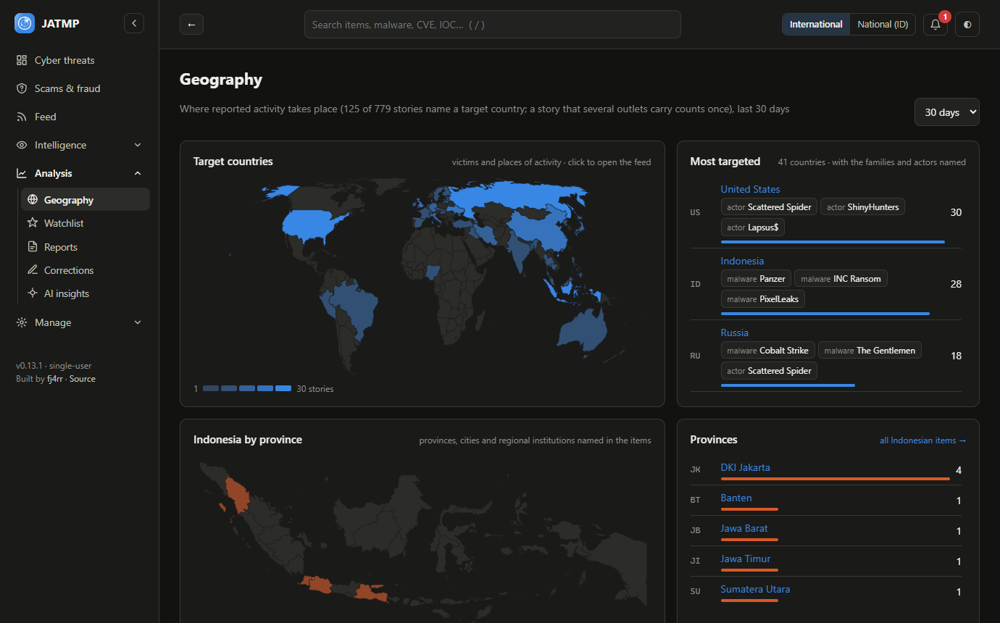
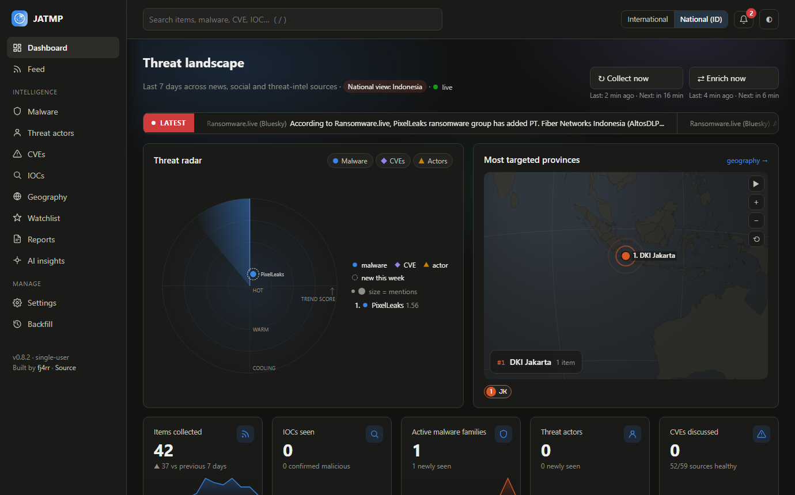
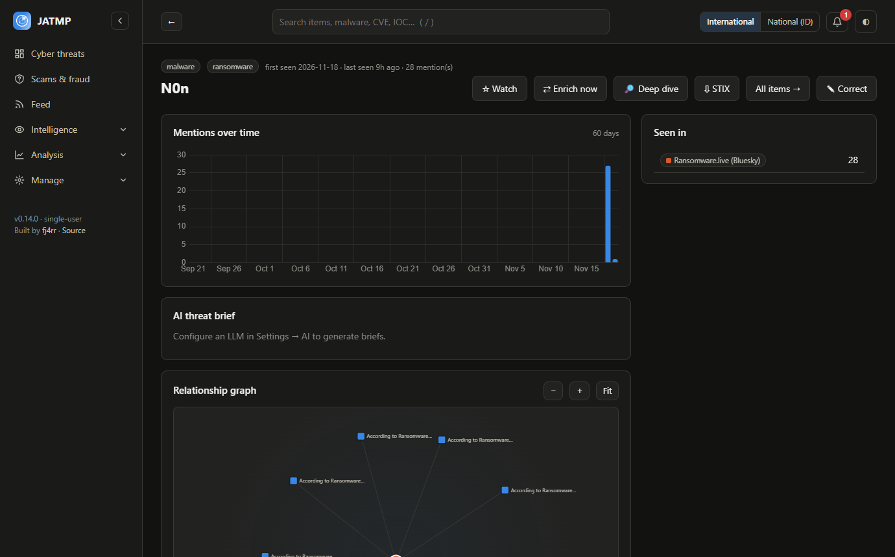
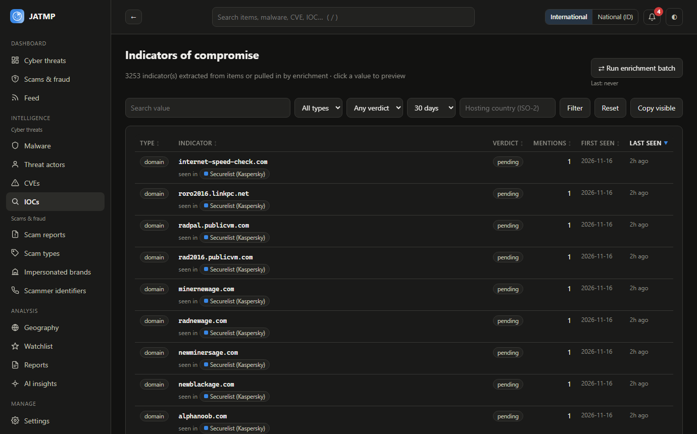
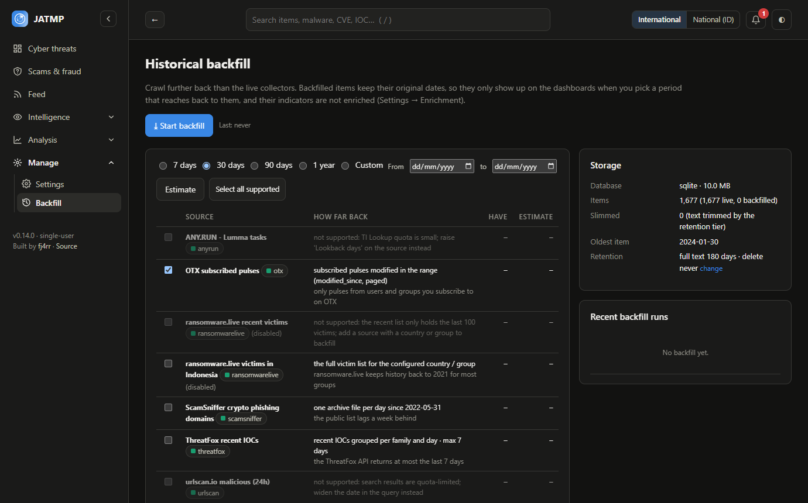
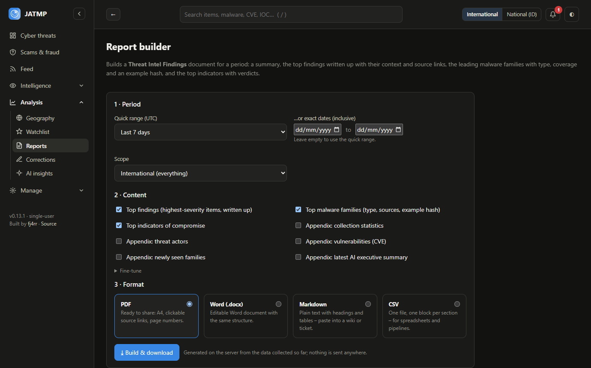

# Screenshots

[← Documentation index](README.md)

A tour of the interface as of 0.8.

Dashboard: International / National (ID) switch, *Collect now* / *Enrich now* with last and next run,
notification bell, headline ticker, threat radar, KPI tiles with sparklines, collection volume and trending
families.

| Trending CVEs (CISA KEV, CVSS, EPSS, risk-weighted priority) and trending threat actors with their families | Feed with the side preview: severity breakdown, entities and indicators without leaving the list |
|---|---|
|  |  |

| Item page: severity, STIX export, extracted entities with their verdicts | Relationship graph: the item, its entities and the other items that share them |
|---|---|
|  |  |

| Geography: target countries on a world map, with the families and actors named per country | National (ID) view: the dashboard limited to Indonesia, with the province map |
|---|---|
|  |  |

| Malware family page: timeline, coverage per source, Deep dive, graph, co-mentioned entities | IOC table with verdicts, hosting countries, attributed families and where each indicator was seen |
|---|---|
|  |  |

| Malware families: unified table with trend score, related entities and pagination | CVE list sorted by EPSS, with KEV badges and co-mentioned families |
|---|---|
|  |  |

| Historical backfill: per-source reach and method, estimates and storage statistics | AI settings: local or cloud, vendor presets and a live model list |
|---|---|
|  |  |

| Report builder: period, content and format for the *Threat Intel Findings* document |
|---|
|  |
