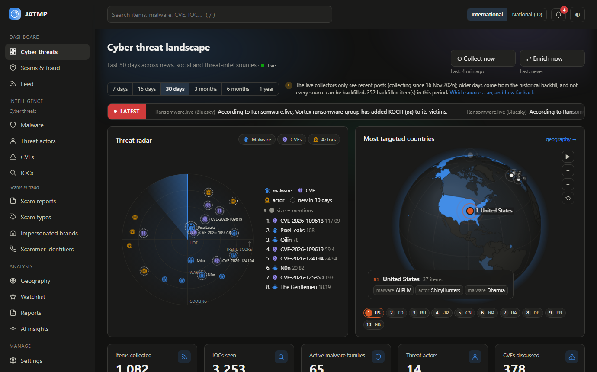
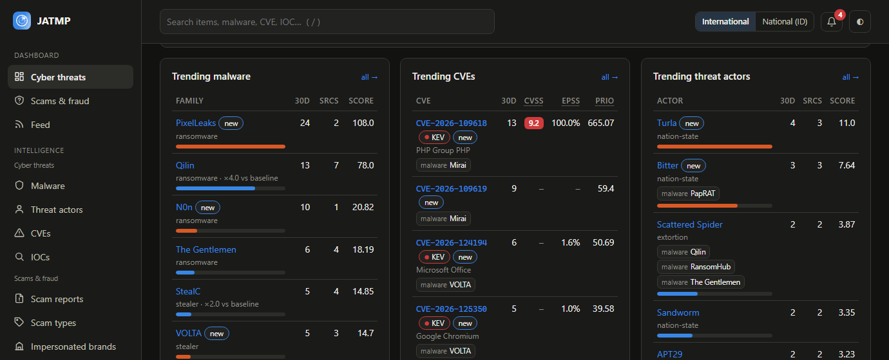
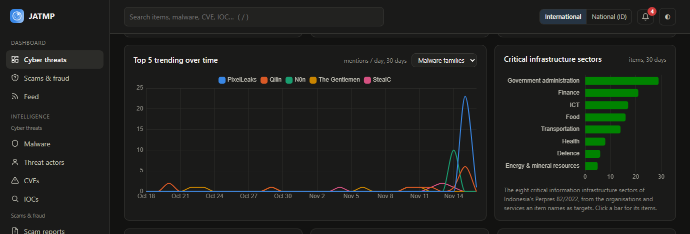
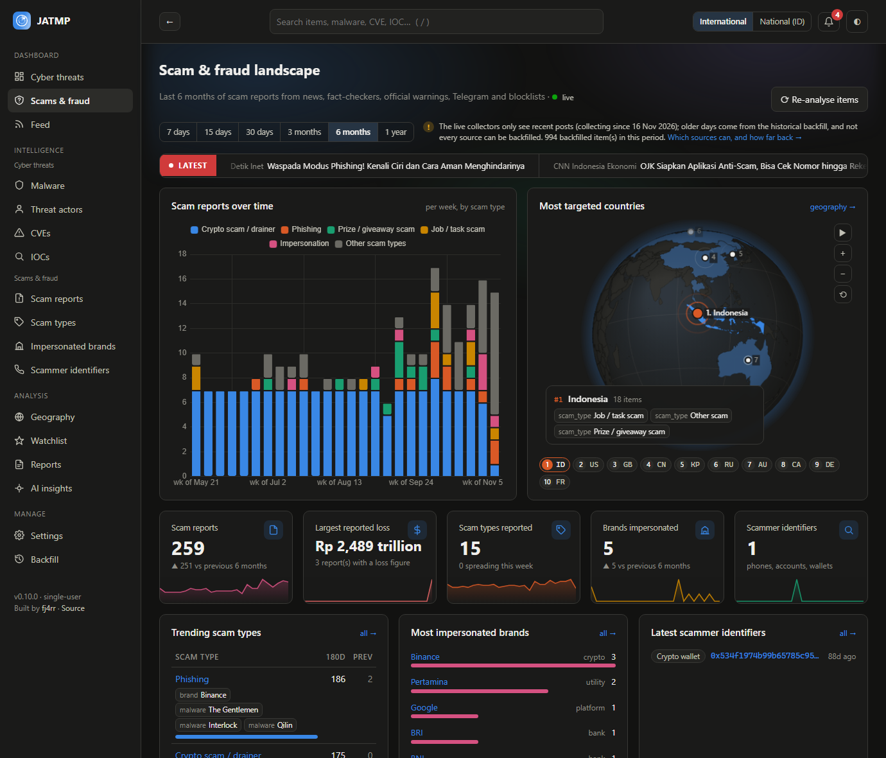
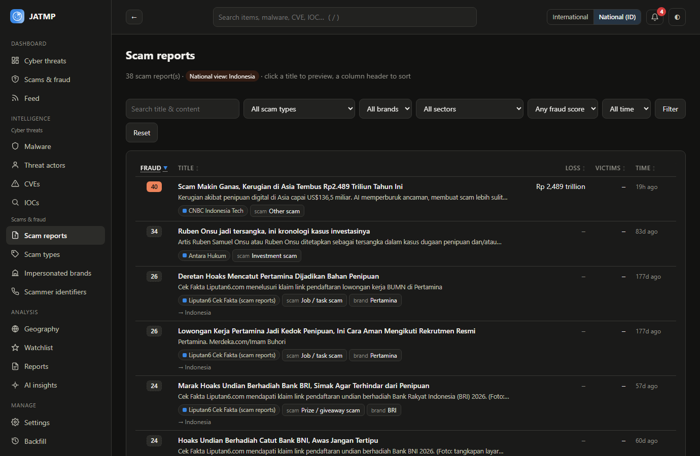
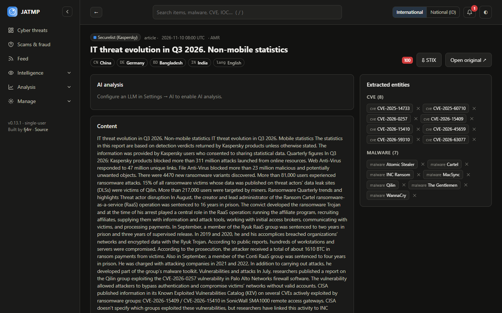
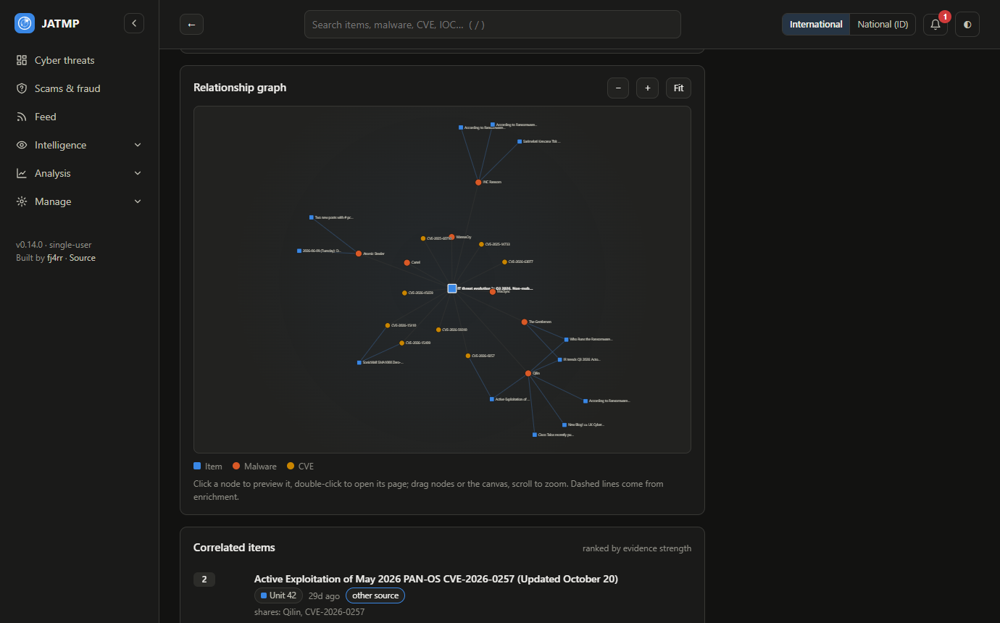
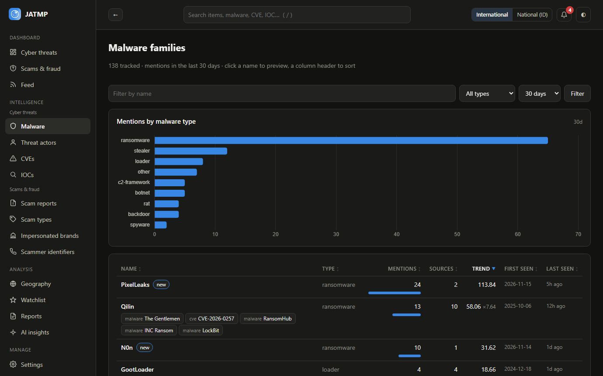
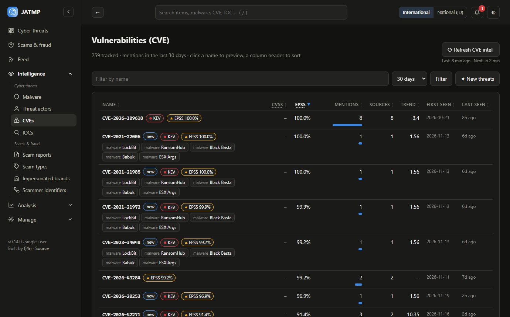
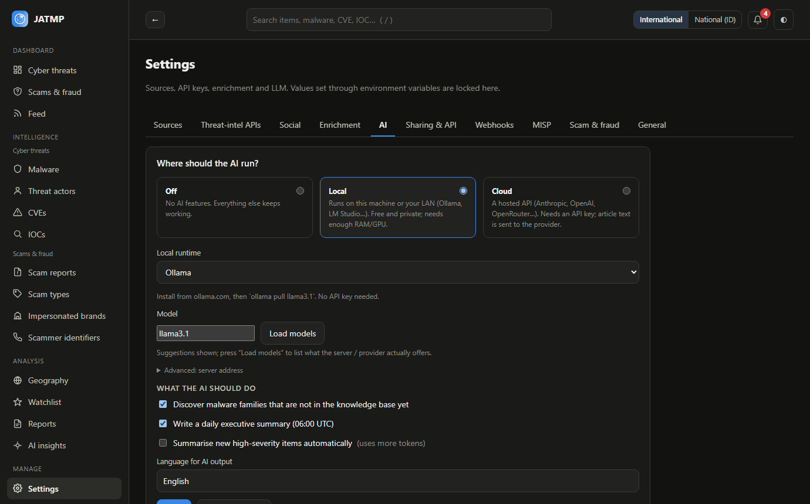

# Screenshots

[← Documentation index](README.md)

A tour of the interface. The dashboards, scam & fraud pages and backfill page are as of 0.10, the other pages
as of 0.8.2 (the sidebar in those shots predates the two dashboards).

Cyber threats dashboard: the sidebar with the two dashboards and the cyber and scam pages under *Intelligence*,
the period switch (7 days to 1 year) with the backfill note, International / National (ID) switch, *Collect now*
/ *Enrich now* with last and next run, headline ticker, threat radar with families, CVEs and actors, the globe of
the top 10 target countries, and the KPI tiles.

| Trending malware, CVEs (CISA KEV, CVSS, EPSS, risk-weighted priority) and threat actors over the chosen period | Top 5 trending over time next to the critical infrastructure sectors of the period |
|---|---|
|  |  |

Scams & fraud dashboard (0.10): scam reports over time stacked by scam type, the most targeted countries, tiles
for reports, losses, scam types, brands and scammer identifiers, then trending scam types, impersonated brands
and the latest identifiers.

| Scam reports ranked by fraud score, with losses in rupiah, scam types and brands | Feed with the side preview: severity breakdown, entities and indicators without leaving the list |
|---|---|
|  |  |

| Item page: severity, STIX export, extracted entities with their verdicts | Relationship graph: the item, its entities and the other items that share them |
|---|---|
|  |  |

| Geography: target countries on a world map, with the families and actors named per country | National (ID) view: the dashboard limited to Indonesia, with the globe on the provinces |
|---|---|
|  |  |

| Malware family page: timeline, coverage per source, Deep dive, graph, co-mentioned entities | IOC table with verdicts, hosting countries, attributed families and where each indicator was seen |
|---|---|
|  |  |

| Malware families: unified table with trend score, related entities and pagination | CVE list sorted by EPSS, with KEV badges and co-mentioned families |
|---|---|
|  |  |

| Historical backfill: *Start backfill* under the description, per-source reach and method, estimates and storage statistics | AI settings: local or cloud, vendor presets and a live model list |
|---|---|
|  |  |

| Report builder: period, content and format for the *Threat Intel Findings* document |
|---|
|  |
